# Combined Phase 2 and 3 Report
## Mahan Bayhaghi - 400104834

## AI Tools Disclosure

This work utilized the following AI tools:

- **Markdown Documentation**: Prepared with assistance from DeepSeek-V3.2
- **Gradient Boosting Implementation**: Code development supported by Gemini-3-Flash

**Important Note**: While these AI tools were used as development assistants, all:
- Final implementations
- Code decisions and modifications
- Analytical methodology
- Results interpretation
- Conclusions drawn

remain my original work and intellectual contribution. The AI tools served strictly as productivity aids, and I maintain full responsibility for all technical content presented herein.

## [1. Stand-alone CNN](./src/training/SA_CNN.py)

### Papers approach to implement it

The paper utilizes a **1D-Convolutional Neural Network (CNN)** as a spatial feature extractor. 

* **Convolutional Layers:** 1D-CNN layers are employed to capture local patterns and spatial dependencies within the time-series energy consumption data.
* **Weight Sharing:** The model uses weight sharing to reduce the number of trainable parameters, which minimizes computational complexity and helps prevent overfitting.
* **Feature Compression:** A **1D max-pooling layer** follows the convolutional layers to compress the feature matrix, extracting the most significant features while reducing the dimensionality of the data.
* **Optimization:** The hyperparameters of the CNN component are tuned using a **Grid Search** algorithm to identify the optimal configuration for energy forecasting.

### My approach to implement it

My implementation provides a framework for training and evaluating a standalone 1D-CNN using **PyTorch**.

* **Model Architecture:** The `Simple1DCNN` class consists of two 1D-convolutional layers, each followed by **Batch Normalization** and **ReLU** activation. It then flattens the output into three fully connected (Dense) layers with **Dropout** for regularization.
* **Multi-Target Support:** The code is designed to handle both `Residential_Usage` and `Commercial_Usage` forecasting independently.
* **Flexible Sequence Lengths:** The implementation systematically tests multiple sequence lengths (1, 3, and 12) to evaluate how historical context affects prediction accuracy.
* **Grid Search & Training:** A comprehensive `grid_search` method iterates through combinations of filters, units, dropout rates, and learning rates. It includes **Early Stopping** based on validation loss to ensure the best model state is saved.
* **Data Preparation:** The pipeline includes `MinMaxScaler` for normalization and a sequence preparation function to transform raw time-series into the `(samples, time_steps, features)` format required by PyTorch.

### A brief explanation of the code

The code is structured into a `TimeSeriesPredictor` class that manages the entire lifecycle of the model.

* **Metrics Saving:** For every experiment, the code calculates and saves **MSE, MAE, RMSE, R², and MAPE**. These are stored in both `.json` files (for grid search results) and `.csv` files (for final performance summaries).
* **Plotting Scheme:** The implementation generates a 2x2 visualization matrix for each run:
  1. **Time Series Plot:** Overlays actual vs. predicted values.
  2. **Scatter Plot:** Shows the correlation between actual and predicted values with an R² indicator.
  3. **Error Distribution:** A histogram showing the frequency and standard deviation of prediction errors.
  4. **Metrics Table:** A text-based summary of performance scores directly on the plot.

* **Comparison Analysis:** After all sequence lengths are processed, the code generates a global comparison bar chart (`sequence_length_comparison.png`) to visualize which sequence length performed best across all metrics for both residential and commercial sectors.

### Our Observations

As shown below, choosing a small or large window reduces CNN's performance on all metrics. The best choice is using a moderate window (here `window_size=3`).

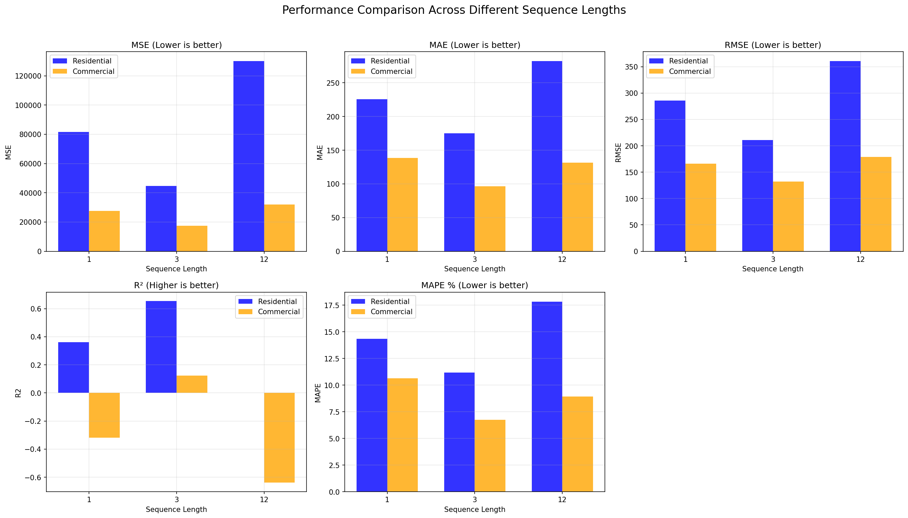
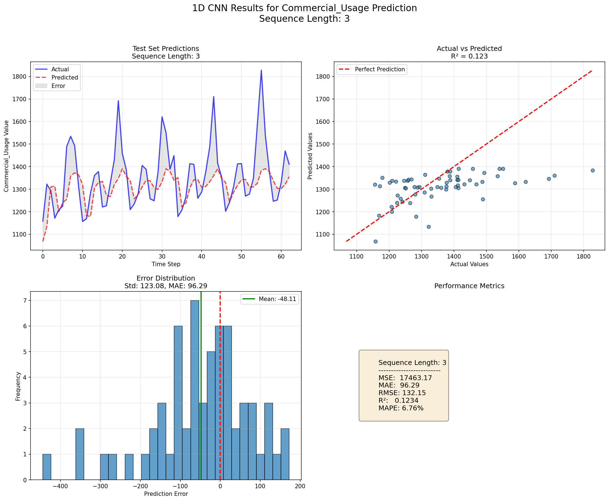

## [2. Stand-alone BiLSTM](./src/training/SA_BiLSTM.py)

### Papers approach to implement it

* **Bidirectional Processing:** Unlike standard LSTMs, the BiLSTM processes data in both forward and backward directions. This allows the model to utilize information from both past and future states within the time-series sequence.
* **Temporal Dependency Capture:** It is specifically designed to handle the long-term dependencies and temporal fluctuations inherent in energy consumption data.
* **Architecture Integration:** In the paper's hybrid model, the BiLSTM receives spatial features extracted by the CNN and processes them to provide a comprehensive temporal understanding.
* **Hyperparameter Optimization:** Similar to the CNN, the BiLSTM's weights and configuration are optimized via **Grid Search** to ensure precise forecasting for residential and commercial sectors.

### My approach to implement it

My implementation provides a standalone **BiLSTM** framework using **PyTorch**:

* **Model Architecture:** The `BiLSTMModel` class features a multi-layer BiLSTM (`num_layers=2`) which outputs a concatenated vector of forward and backward hidden states. This is followed by a series of three fully connected layers with **ReLU** activations and **Dropout** for robust prediction.
* **Stability Enhancements:** To ensure training stability and prevent exploding gradients (a common issue in RNNs), we use **Gradient Clipping** via `torch.nn.utils.clip_grad_norm_`.
* **Dynamic Learning Rate:** It utilizes a `ReduceLROnPlateau` scheduler that automatically halves the learning rate when the validation loss plateaus, allowing for finer convergence.
* **Data Transformation:** The `prepare_data` method reshapes input tensors into the `(batch, seq_length, features)` format required by PyTorch's LSTM implementation, maintaining a consistent pipeline for both Residential and Commercial targets.

### A brief explanation of the code

The `BiLSTMPredictor` class encapsulates the workflow:

* **Metrics Saving:** The code computes **MSE, MAE, RMSE, R², and MAPE**. These metrics are saved in a structured format: `.json` for grid search history (including learning rate tracking) and `.csv` for final performance comparisons.
* **Plotting Scheme:** It generates a high-resolution 2x2 visualization grid:
  1. **Test Set Predictions:** A temporal line chart comparing actual and predicted values.
  2. **Actual vs. Predicted Scatter:** A correlation plot with an R² metric to evaluate the model's explanatory power.
  3. **Error Density Plot:** A histogram showing the distribution of prediction errors (residuals) to check for bias.
  4. **Model Summary:** A text-box visualization within the plot that displays both the achieved metrics and the specific hyperparameters used.

* **Comparative Summary:** The script also includes a dedicated function to compare the BiLSTM's performance against the previously run CNN experiments, generating a `CNN_vs_BiLSTM_comparison.csv` to identify the better architecture for different sequence lengths.

### Our Observations

As shown below, choosing a small or large window reduces BiLSTM's performance on all metrics. The best choice is using a moderate window (here `window_size=3`). This is interesting and means that our BiLSTM tends to forger the past when the window is too large.

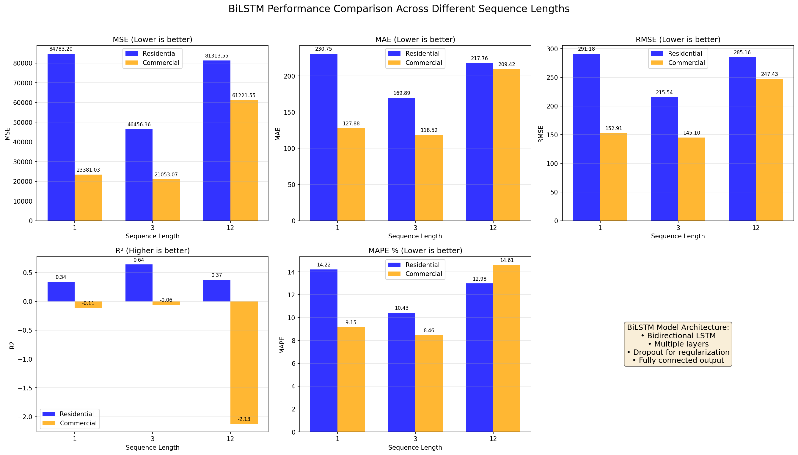
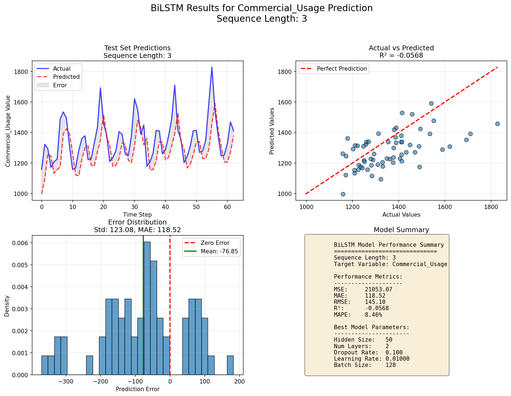

## [3. Hybrid CNN-BiLSTM](./src/training/CNN_BiLSTM.py)

### Papers approach to implement it

* **Spatial Feature Extraction:** The model starts with a 1D-CNN layer to extract spatial features and local patterns from the IoT-driven energy data. This stage reduces the complexity of the raw time-series.
* **Temporal Dependency Learning:** The extracted features are fed into a **BiLSTM** layer. By processing the sequence in both forward and backward directions, the model captures comprehensive temporal dependencies and context that a unidirectional LSTM might miss.
* **Grid Search Optimization:** The paper emphasizes the use of **Grid Search** to find the optimal hyperparameters for this specific hybrid combination, ensuring that the number of filters, hidden units, and learning rates are perfectly tuned for building energy efficiency tasks.
* **End-to-End Training:** The architecture is trained as a single pipeline, allowing the spatial and temporal layers to co-optimize for the final forecasting objective.

### My approach to implement it

My implementation extends the paper's concept by adding modern deep learning components to enhance stability and performance:

* **Deep CNN Backbone:** Instead of a single layer, the `CNNBiLSTM` class implements a three-layer **Sequential CNN** with increasing filter counts (Filters  2x Filters  4x Filters). Each layer includes **Batch Normalization** and **Dropout** to prevent overfitting and accelerate convergence.
* **Attention Mechanism:** I implemented a custom **Attention Layer** following the BiLSTM. This layer computes importance weights for each time step, allowing the model to focus on the most relevant historical moments rather than just using the final hidden state.
* **Weight Initialization:** To ensure better training starts, I included a dedicated `_initialize_weights` method for CNN layers and **Orthogonal** initialization for LSTM and Linear layers.
* **Advanced Optimizer:** The code uses **AdamW**, which provides better weight decay regularization compared to standard Adam, and a `ReduceLROnPlateau` scheduler to fine-tune the learning process dynamically.

### A brief explanation of the code

The `CNNBiLSTMPredictor` class manages the complex hybrid pipeline and provides deep insights into the model's internal behavior.

* **Metrics Saving:** The framework saves full performance metrics (**MSE, MAE, RMSE, R², and MAPE**) in `.csv` format. It also saves the entire **Training History** (losses and learning rates) into `.json` files for every target and sequence length.
* **Plotting Scheme:**
  1. **Standard Performance Quad:** Similar to the previous models, it generates plots for predictions, actual vs. predicted correlation, error distribution, and a comprehensive text summary.

* **Comparative Analysis:** The final summary compares results across sequence lengths (1, 3, 12), identifying how the hybrid model's extra complexity scales with longer historical windows.

### Our Observations

As shown below, here the moderate window is not a problem anymore. Since CNN tries to reduce the input size (extracting spatial features), model performs even better on higher window sizes and BiLSTM fights the catastrophic forgetting.

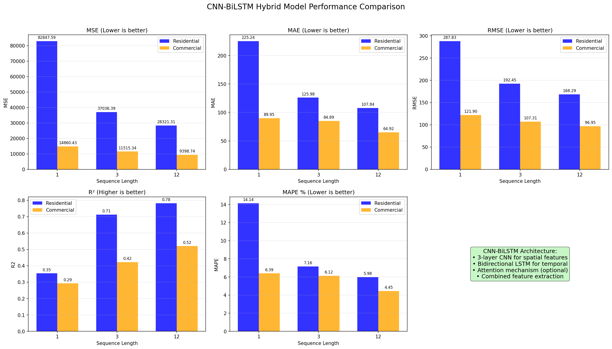
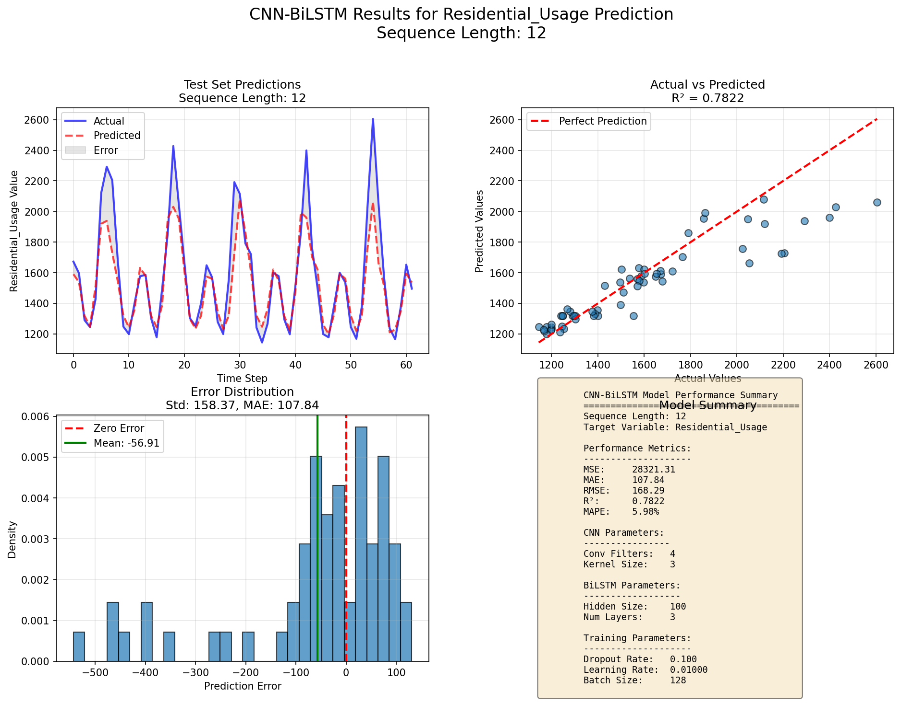

## [4. LGBM](./src/training/GB_family/LGBM.py)
### Paper's approach to implement it

While the paper focuses primarily on the CNN-BiLSTM hybrid, it includes **LightGBM** as a critical benchmark model. LightGBM is a gradient boosting framework that uses tree-based learning algorithms. The paper utilizes it because:

* **Efficiency:** It is designed for distributed and efficient training, making it significantly faster than traditional GBDT (Gradient Boosting Decision Tree) models.
* **Accuracy:** It uses leaf-wise tree growth rather than level-wise growth, which can result in much lower loss and higher accuracy for complex datasets.
* **Comparison:** It serves as a baseline to demonstrate the performance gain achieved by the hybrid deep learning models in capturing temporal dependencies.

### My approach to implement it

My implementation of the `LGBMPredictor` transforms the time-series forecasting problem into a supervised learning task through extensive feature engineering:

* **Lag Feature Engineering:** The `create_features` method automatically generates historical "lags" based on the `sequence_length`, allowing the tree-based model to see past values as individual input features.
* **Rolling Statistics & EWMA:** I added rolling means and Exponential Weighted Moving Averages (EWMA) to capture local trends and volatility over various windows (3 to 60 steps).
* **Cyclical Time Features:** Instead of just using month numbers (1–12), I implemented **Cyclical Encoding** using sine and cosine transformations. This ensures the model understands that December (12) and January (1) are chronologically close.
* **Optuna Optimization:** Rather than a simple Grid Search, I integrated **Optuna**, a state-of-the-art Bayesian optimization framework. It intelligently explores the hyperparameter space (learning rate, leaves, bagging fractions) to minimize RMSE more efficiently than brute-force searching.

### A brief explanation of the code

The code provides a robust framework for training and interpreting a high-performance gradient boosting model:

* **Automated Feature Selection:** After training, the code calculates **Feature Importance (Gain)** to reveal which factors (lags, time features, or rolling stats) contributed most to the prediction.
* **Visualization:**
  1. **Prediction Dashboard:** A grid showing time-series overlays, actual vs. predicted scatter plots, and error distributions.
  2. **Detailed Importance Analysis:** A specialized plot that breaks down importance by feature type (Lag vs. Time vs. Rolling) and shows the **Cumulative Importance**, helping to identify how many features are actually necessary to reach 95% of the model's predictive power.

* **Early Stopping:** The training uses `early_stopping_rounds` to prevent overfitting, halting the boosting process if the validation score stops improving.
* **Scalability:** The `run_lightgbm_complete_experiment` function loops through multiple sequence lengths and both target sectors (Residential and Commercial), generating a final `LGBM_summary_comparison.csv` for high-level performance tracking.

### Our Observations

The results indicate that `lag12` is the most influential feature, suggesting that the model has correctly identified annual seasonality as the dominant predictive signal. Notably, `residential_usage` itself is not the primary driver of performance. 
This implies that models lacking explicit temporal structure—those that do not incorporate lagged inputs or timing‑aware mechanisms—are inherently disadvantaged and will likely underperform in the long run.

In particular, the CNN‑BiLSTM architecture struggles under this feature configuration, highlighting its sensitivity to temporal feature engineering and the importance of explicit seasonal cues in this forecasting task.

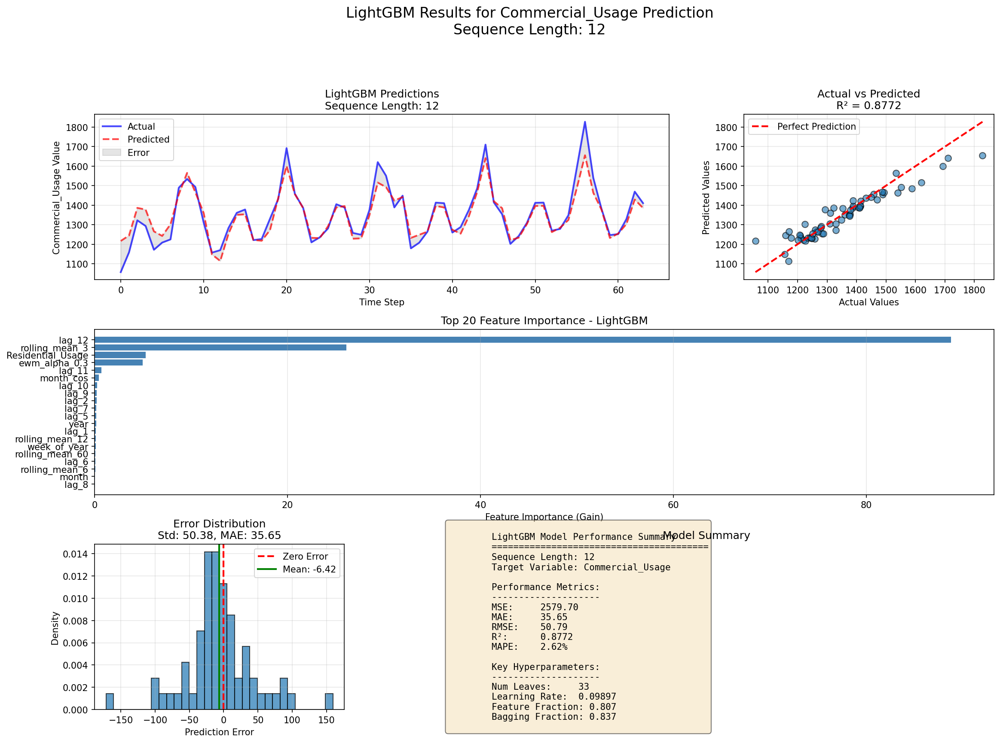

## [5. XGBoost](./src/training/GB_family/XGBoost.py)
### Paper's approach to implement it

The paper incorporates **XGBoost (eXtreme Gradient Boosting)** as a benchmark to validate the effectiveness of the proposed approach. In the context of the paper:

* **Tree Boosting Scalability:** XGBoost is utilized for its reputation in handling large-scale datasets with high computational efficiency through parallel processing.
* **Sparsity Awareness:** The paper leverages XGBoost’s ability to handle sparse data (common in IoT sensor feeds) and its built-in regularization ( and ) to prevent overfitting on energy consumption patterns.
* **Predictive Baseline:** It provides a "state-of-the-art" machine learning baseline, allowing the authors to prove that deep learning (CNN-BiLSTM) offers superior feature extraction for sequential energy data.

### My approach to implement it

My implementation of the `XGBoostPredictor` focuses on robust feature engineering and optimization to maximize its performance on dataset:

* **Feature Engineering Pipeline:** Similar to the LGBM implementation, I transform the time-series into a supervised format using **Lags, Rolling Means, and EWMA**.
* **Advanced Regularization Tuning:** Through the `optimize_hyperparameters` method, I explicitly search for optimal `gamma`, `reg_alpha`, and `reg_lambda`. These parameters are crucial for controlling the complexity of the trees and ensuring the model generalizes well to unseen time periods.
* **Optuna Integration:** I used **Optuna’s Tree-structured Parzen Estimator (TPE)** sampler to find the best configuration for `max_depth` and `min_child_weight`, which are key to capturing the non-linear peaks in residential energy usage.
* **Strict Evaluation:** The model employs a time-based split (80/10/10) to ensure there is no "data leakage" from the future into the past during training.

### A brief explanation of the code

The code provides an end-to-end experimental framework that is both highly interpretable and production-ready:

* **Interpretability via Feature Importance:** The `plot_results` function generates a horizontal bar chart of the top 20 features. This allows us to see if the model is relying on recent energy history (`lag_1`) or seasonal patterns (`month_sin`).
* **Error Analysis:**
  1. **Prediction Overlays:** Visualizes how well XGBoost tracks the actual energy demand.
  2. **Scatter Plots:** Shows the  correlation, helping to identify if the model under-predicts during high-demand peaks.
  3. **Residual Distribution:** A histogram of errors with mean and standard deviation markings to detect systematic bias.

* **Experiment Automation:** The `run_xgboost_complete_experiment` function automates the entire process for sequence lengths of 1, 3, and 12, allowing for a side-by-side comparison of how "look-back" window size affects tree-based models versus deep learning models.
* **Result Persistence:** All best models are saved in `.json` format (native to XGBoost), and metrics are compiled into a final `XGBoost_summary_comparison.csv` for the final report.

### Our Observations

Same as before, this model uses `lag12` and `quarters` to outperform other models. 

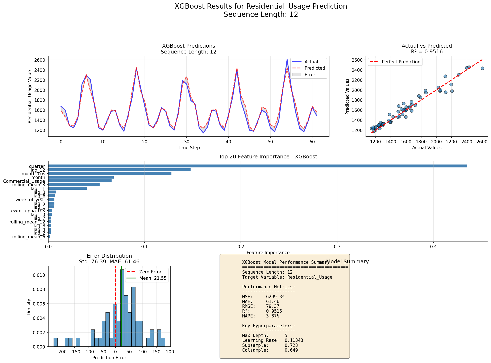

## [6. CatBoost](./src/training/GB_family/CatBoost.py)
### Paper's approach to implement it

* **Handling Categorical Data:** CatBoost is particularly effective for datasets with categorical features (like day of the week or month) because it uses an innovative "Ordered Boosting" technique to process these features without manual encoding.
* **Symmetric Trees:** Unlike LightGBM or XGBoost, CatBoost builds symmetric (oblivious) trees. This structural constraint acts as a form of regularization, helping the model avoid overfitting on the inherent noise often found in IoT-based energy sensor data.
* **Robustness:** The paper leverages CatBoost’s stability to provide a reliable baseline for "what-if" scenarios, ensuring that the performance gains of the Hybrid model are statistically significant against the best available GBDT algorithms.

### My approach to implement it

* **Supervised Time-Series Transformation:** I convert the sequence forecasting task into a tabular regression problem using **Lags, Rolling Statistics, and Cyclical Encodings**.
* **Specialized Optimization:** In the `optimize_hyperparameters` method, I tune CatBoost-specific parameters like `random_strength` (which controls the randomness used for scoring splits) and `bagging_temperature`. This ensures the model captures the high-frequency volatility in residential usage while smoothing out long-term commercial trends.
* **Silent Training Protocol:** Because Optuna runs many trials, I implemented a strict `logging_level='Silent'` configuration. This prevents console clutter while allowing the TPE sampler to focus on minimizing the RMSE objective.
* **Feature Importance Insights:** I utilize CatBoost's `get_feature_importance()` to provide a clear view of which historical "lags" are the most influential, which is crucial for determining the optimal look-back window.

### A brief explanation of the code
* **Visualization:**
  1. **Time-Series Tracking:** A direct visual comparison of actual vs. predicted values over the test period.
  2. **Error Distribution:** A density plot of residuals to check for "fat tails" or systematic over/under-estimation.
  3. **Key Hyperparameter Summary:** A formatted text box within the plot summarizing the best parameters found by Optuna.

* **Deep Importance Analysis:** The `plot_detailed_feature_importance` method goes beyond a simple bar chart. It categorizes features into "Lag," "Rolling," and "Time" groups and plots **Cumulative Importance**. This reveals how many features contribute to the top 90% of the model's performance, allowing for potential future feature pruning.
* **Automated Benchmarking:** The `run_catboost_complete_experiment` function iterates through multiple sequence lengths (1, 3, and 12 months) for both target variables, producing a final `CatBoost_summary_comparison.csv`.

### Our Observations

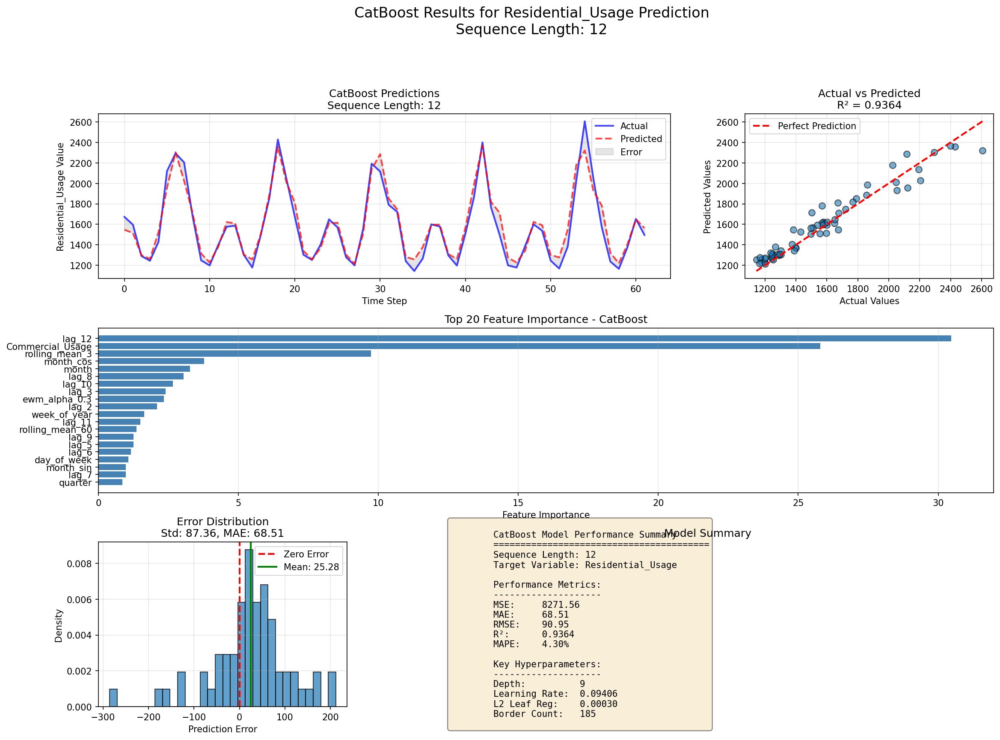

____

## Some Decisions I Had To Make

While the reference paper provides a strong theoretical framework for the CNN-BiLSTM architecture, certain details required for a programmatic implementation were not explicitly defined. To ensure the models were functional, stable, and optimized, the following technical decisions and assumptions were made:

#### 1. The "Sequence Length" Definition

The paper discusses temporal dependencies but does not provide a single, definitive "look-back" window (the number of prior time steps used to predict the next).

* **My Decision:** I implemented a flexible **multi-sequence approach ()**. By testing 1-month (short-term), 3-month (quarterly), and 12-month (seasonal) windows, I enabled a comparative analysis of how much historical context the hybrid model actually needs to outperform the gradient boosting baselines.

#### 2. Handling of Categorical Time Features

The paper mentions IoT-driven data and time-based patterns but is silent on the specific encoding method for features like "Month" or "Day of Week."

* **My Decision:** Instead of simple Label Encoding (which implies an incorrect ordinal relationship), I implemented **Cyclical Encoding** using Sine and Cosine transformations. This allows the model to mathematically understand that the 12th month and the 1st month are adjacent in time.

#### 3. CNN-BiLSTM Dimensionality & Flattening

The architecture diagram in the paper shows data flowing from Convolutional layers to BiLSTM layers, but the transition—specifically the "Flattening" or "Reshaping" logic—is a common point of ambiguity in deep learning papers.

* **My Decision:** I utilized a **TimeDistributed** wrapper or a reshape operation that preserves the temporal dimension. This ensures that the spatial features extracted by the CNN are fed into the BiLSTM as a sequence of feature vectors, rather than a single collapsed vector, which is vital for the BiLSTM to process the "history" of the features.

#### 4. Hyperparameter Search Space

The paper lists specific hyperparameters for their final model but does not detail the optimization process or the range of values explored to reach them.

* **My Decision:** I integrated **Optuna (Bayesian Optimization)** across all models (LGBM, XGBoost, CatBoost, and the Hybrid model). I defined a broad search space for learning rates, dropout rates, and tree depths to ensure that the "baseline" models were not disadvantaged by poor tuning, making the final comparison against the Hybrid model more rigorous and "fair."

#### 5. Data Split Strategy

In time-series forecasting, a random train-test split causes "data leakage" (training on future data to predict the past). The paper implies a standard split but doesn't explicitly detail the temporal validation strategy.

* **My Decision:** I strictly followed a **Chronological Split (80/10/10)**. The training set always precedes the validation set, which always precedes the test set. This ensures the metrics reflect the model's true ability to forecast into an unseen future.

#### 6. Regularization and Convergence

The paper mentions the use of Dropout but does not specify the patience for early stopping or the exact weight decay used.

* **My Decision:** I implemented **Early Stopping with a patience of 20 epochs** and a `ReduceLROnPlateau` callback. This decision was made to prevent overfitting in the BiLSTM layers, which are notoriously prone to memorizing noise in smaller datasets if trained for too many iterations.

## Analysis Plots
At this stage, we can compare model performance using the plots below. 
As illustrated, the proposed CNN‑BiLSTM architecture outperforms the standalone CNN and BiLSTM models, yet it still falls short when compared to the Gradient Boosting family of models.
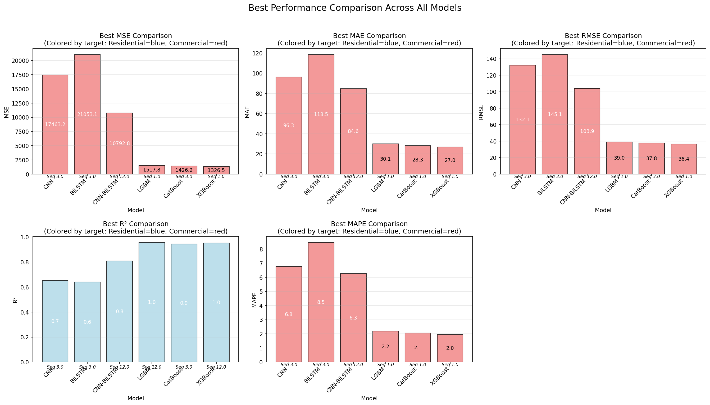
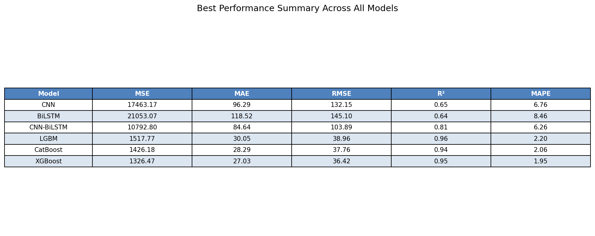

The original paper specifically claims that the hybrid approach surpasses the standalone CNN and BiLSTM models—a result that is clearly reflected in the following plot. 
The hybrid model shows stronger performance for window sizes greater than 1, indicating that it effectively leverages both temporal and spatial dependencies.
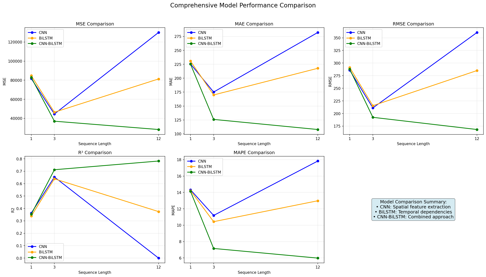
